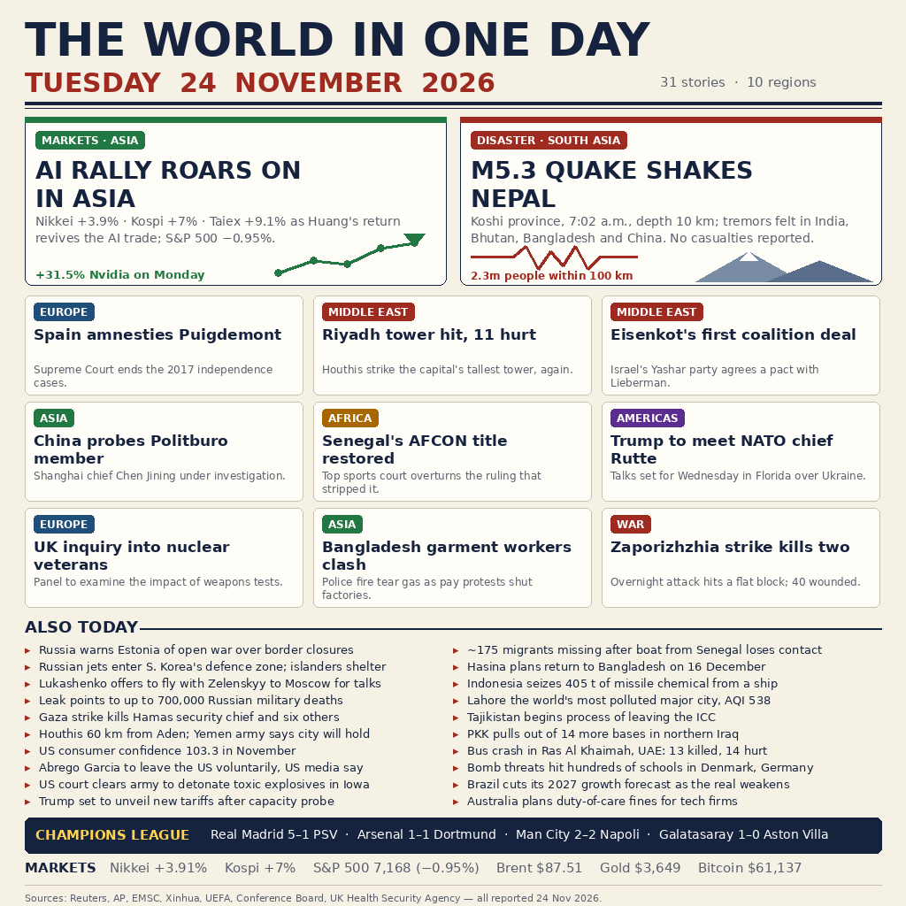

# The World in One Day — Tuesday 24 November 2026

A single front-page poster that sums up Tuesday 24 November 2026's world news in one image — an entry for the [make.fun bounty "Sum up 24 November's world news in one image"](https://make.fun/bounty/news-image-20261124). This is version 2: the full day, 31 stories across 10 regions, drawn after the day had ended everywhere.

The ten regions covered: North America, South America, Europe, the Middle East, Africa, South Asia, East Asia, Southeast Asia, Central Asia and Oceania — plus a Champions League results strip and a markets strip.

## What's on the poster

**Lead — the AI rally roars on in Asia.** Japan's Nikkei closed up 3.91% at 58,644.63, South Korea's Kospi jumped about 7% and Taiwan's Taiex 9.1%, as Jensen Huang's return as Nvidia chief revived the AI trade. Nvidia itself had surged 31.5% on Monday. Wall Street cooled: the S&P 500 fell 0.95% as rate-hike bets grew. Sources: Reuters, dpa-AFX, TradingView (24 November 2026).

**Lead — M5.3 quake shakes Nepal.** A magnitude 5.3 earthquake struck Koshi province at 7:02 a.m., at a depth of 10 km. Tremors were felt in India, Bhutan, Bangladesh and China; about 2.3 million people live within 100 km. No casualties were reported. Sources: EMSC, Reuters, India's National Centre for Seismology (24 November 2026).

**Nine region stories:** Spain amnesties Carles Puigdemont; Houthis strike Riyadh's tallest tower, injuring 11; Eisenkot clinches his first coalition deal in Israel; China investigates Politburo member Chen Jining; the top sports court restores Senegal as AFCON 2025 champions; Trump is to meet NATO chief Rutte; the UK opens an inquiry into nuclear-test veterans; Bangladesh garment workers clash with police over pay; a Russian strike on Zaporizhzhia kills two.

**Also today:** Russia warns Estonia over border closures; Russian jets enter South Korea's defence zone; Lukashenko offers to fly with Zelenskyy to Moscow; a leak points to up to 700,000 Russian military deaths; a Gaza strike kills a Hamas security chief; Houthis close to 60 km from Aden; US consumer confidence at 103.3; Abrego Garcia to leave the US voluntarily; a US court clears the army to detonate toxic explosives in Iowa; new Trump tariffs expected; ~175 migrants missing after a boat from Senegal loses contact; Hasina plans her return to Bangladesh; Indonesia seizes 405 tonnes of missile chemical; Lahore is the world's most polluted major city; Tajikistan begins leaving the ICC; the PKK pulls out of 14 more bases; a bus crash in Ras Al Khaimah kills 13; bomb threats hit schools in Denmark and Germany; Brazil cuts its 2027 growth forecast; Australia plans duty-of-care fines for tech firms.

**Sport:** Champions League matchday 5 — Real Madrid 5–1 PSV, Arsenal 1–1 Dortmund, Manchester City 2–2 Napoli, Galatasaray 1–0 Aston Villa. Source: UEFA (24 November 2026).

**Markets:** Nikkei +3.91%, Kospi +7%, S&P 500 7,168 (−0.95%), Brent $87.51, gold $3,649, Bitcoin $61,137.

## Research notes

Every story on the poster happened, or was first reported, on Tuesday 24 November 2026. Stories checked and deliberately left out because they belong to an earlier day: the COP31 collapse (22–23 Nov), the Libya warship sinking (22 Nov, reported 23 Nov), the US blacklisting of Alibaba's subsidiary and Megaspeed (23 Nov), and the Philippines' Mount Mayon eruption (20 Nov).

## How it works

- `poster.py` — a Python program that draws the whole poster with Pillow (warm paper background, navy ink, region-coloured tags). Every illustration is drawn in code — the rising market chart, the Himalayan ridges with a seismograph trace — and all text is word-wrapped to fit its box. Run `python3 poster.py` to regenerate `poster.png` (1024×1024).
- `main.py` — the Python 3.13 entry point. It copies `poster.png` into the directory from the `MAKEFUN_OUTPUT_DIR` environment variable (default `/output`), creating the directory if needed. It uses only the Python standard library and no network, so running it twice gives byte-identical output.
- `poster.png` — the finished poster, 1024×1024, under 1 MiB.

## License

MIT — see [LICENSE](LICENSE).

New to make.fun? I got started through this link, and it supports my entries at no cost to you: https://make.fun/r/vy8jjegg
